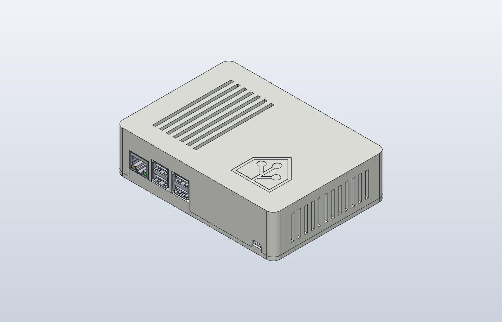
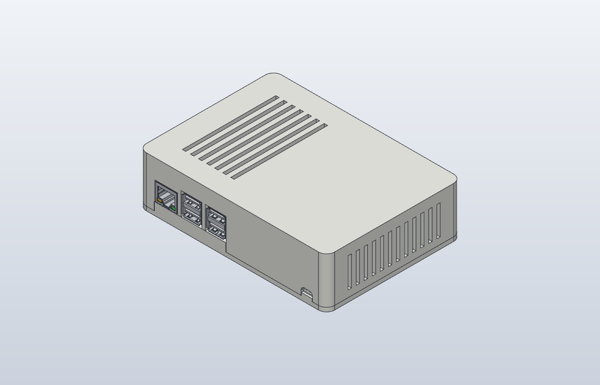
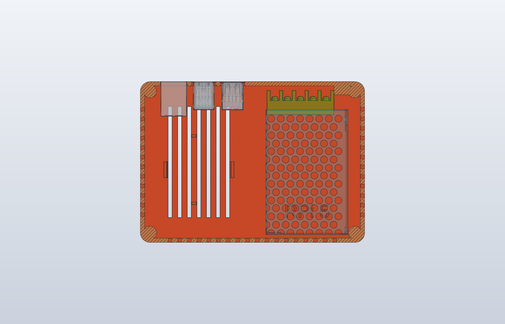

# Raspberry Pi 4 / 5 enclosure with built-in Mean Well RS-25-5 power supply

A two-part 3D-printed enclosure that holds a Raspberry Pi 4 or Raspberry Pi 5 next to a Mean Well RS-25-5 (5 V, 5 A) power supply. One mains cable goes in. Nothing else hangs off the box. It stands on a shelf or hangs on a wall from two keyholes.

| Home Assistant | Raspberry Pi | No logo |
|---|---|---|
|  |  |  |

Inside the lid: the 40 mm fan clips and the board name.

## Features

- One base for both boards. The Pi 4 and Pi 5 share the board outline and the 58 × 49 mm M2.5 hole pattern, so only the lid changes.
- Lids for Raspberry Pi 4 and Raspberry Pi 5. The USB and Ethernet cut-outs swap sides between the two boards, and the lid follows.
- Optional 30 mm or 40 mm fan that snaps into the lid on two clips and blows down onto the SoC. No screws.
- Three lid tops: the Home Assistant logo, the Raspberry Pi logo, or no logo. The board name (`RPi 4` or `RPi 5`) is recessed into the inside of the lid.
- Heat-set inserts everywhere a screw goes into plastic.
- Strain relief for a flat 2-core mains cable, printed into the base and the lid.
- Ventilation slots on the top, the side and the back. The power supply sits 2.5 mm off the back wall and 2.5 mm above the base for airflow.
- Keyhole wall mount with the two holes 50 mm apart and centred on the base.
- Fully parametric source in [SolidCraft](cad/RPi-PSU-enclosure.sc), plus STEP files for other CAD tools.

Outside size: 140 × 100.5 × 37.5 mm.

## Which files to print

Print one base and one lid.

| File | For |
|---|---|
| `stl/base.stl` | Every variant. |
| `stl/lid_rpi5_<logo>.stl` | Raspberry Pi 5, no fan. |
| `stl/lid_rpi5_<logo>_fan40.stl` | Raspberry Pi 5, 40 × 40 × 10 mm fan. |
| `stl/lid_rpi5_<logo>_fan30.stl` | Raspberry Pi 5, 30 × 30 × 10 mm fan. |
| `stl/lid_rpi4_<logo>*.stl` | The same three options for Raspberry Pi 4. |

`<logo>` is `ha` (Home Assistant logo), `raspberry` (Raspberry Pi logo) or `plain` (no logo). STEP files with the same names are in `step/`.

## Documentation

- [Bill of materials](docs/BOM.md)
- [Printing](docs/printing.md)
- [Assembly](docs/assembly.md)
- [Editing the design](docs/customizing.md)

## Logos

The Home Assistant and Raspberry Pi logos are trademarks of their owners. See [cad/logos](cad/logos/README.md) for the source of each one.

## License

[CC BY-NC-SA 4.0](LICENSE). You may print, change and share this design, also as a remix, if you credit the author, do not sell it or prints of it, and share your changes under the same license.
